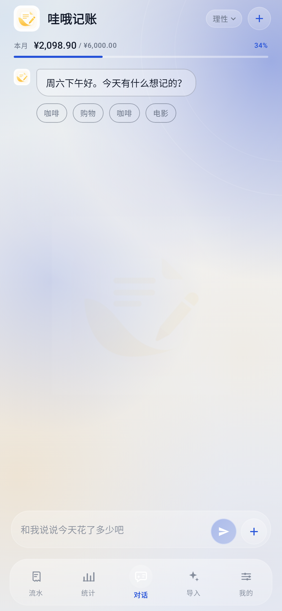
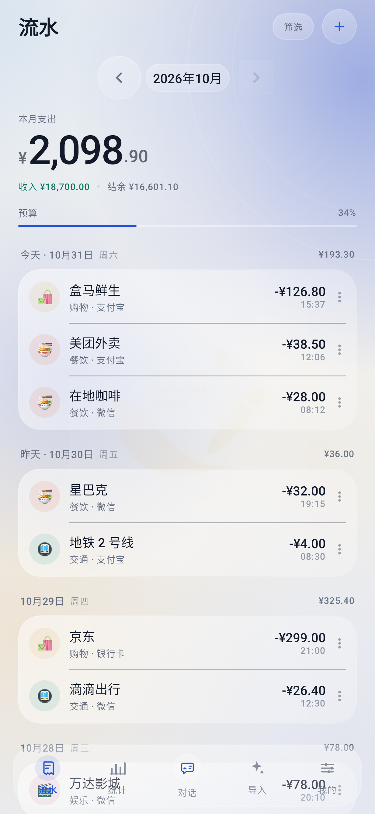
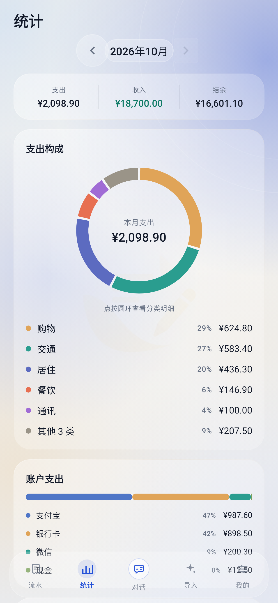
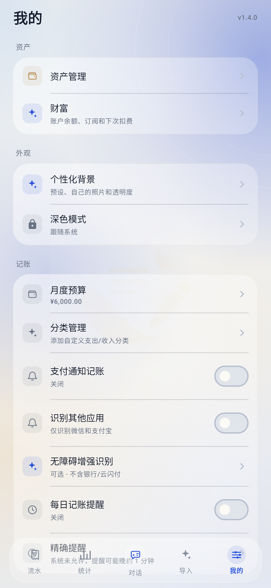
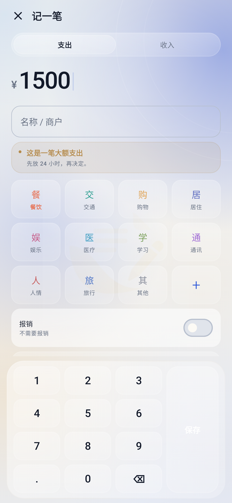

# 哇哦记账 · WAOO

当前版本：**1.4.0**（versionCode 86）

> 哇哦一下，马上记账。
>
> 更新记录见 [CHANGELOG.md](CHANGELOG.md)。

哇哦记账是一款**原生 Android、对话优先、本地优先**的智能记账 App。首页就是一段和 AI 的对话：说一句「午饭 35，微信」，或者直接发一张账单截图，就能记账；也可以问「这个月还能花多少」。它只在该提醒的时候提醒，不说教。

界面采用**米白 + 雾蓝**的液态玻璃风格：暖米白底、宝石蓝交互、香槟金状态色；玻璃面板和底栏用 Haze 做真实背景模糊。主功能放在底栏：流水、统计、对话、导入、我的，对话居中。默认离线；只有开启 AI 或百度网盘备份后才会联网。

## 功能

- **对话式记账（首页）**：文字或账单截图发给 AI，识别后一键入账；也能问账、问预算。首句会随时段、星期和周末变化。
- **AI 未开启时**：对话页保持空白，只提示打开 AI；流水、统计、导入、我的仍可正常使用。
- **图片识别**：输入框右侧加号支持「相册选择」和「拍照」，图片压缩后交给 DeepSeek `deepseek-flash` 视觉接口；支持 JPEG / PNG / GIF / WebP。
- **聊天风格**：可爱 / 正经 / 理性 / 自定义。无论哪种风格，都会在需要时提示理性消费。
- **预算提醒**：只在该出现的时候出现。普通小额不提示；只有超预算、预算使用达到 90% 或明显大额支出时，才给出不评判的提醒。
- **智能导入**：底栏「导入」入口，粘贴支付宝 / 微信 / 银行短信，或选择 CSV 文件；AI 开启时优先用 AI，失败回退本地规则。
- **手动记账**：流水页右上角「+」，或空账本里的「记一笔」。
- **流水编辑 / 删除**：点账目直接编辑；每行右侧菜单可编辑或删除。
- **自动分类学习**：查看、编辑、删除已经学到的商家分类规则。
- **支付通知自动记账（可选）**：支付宝 / 微信支付通知本地解析，自动入账。
- **CSV 导入 / 导出**：统一格式，可在 Excel / Numbers / 飞书表格编辑后再导回。
- **完整 JSON 备份 / 恢复**：包含账目、预算、分类规则，不包含任何 API Key。
- **百度网盘备份（可选，需开发者应用）**：设备码登录、指定 `/apps/` 目录、约每 24 小时自动上传；支持从最新网盘备份恢复（覆盖当前账本前会提示），并可用玻璃滑杆设置保留最近 N 个备份或不限。
- **统计**：分类环形图、每日支出柱状图、常去商家。
- **每日提醒**：可设置每天的记账提醒时间，使用 WorkManager 调度。
- **动效**：底栏选中态、圆形按钮、发送/加号采用按压回弹、颜色过渡和消息入场动画。
- **统一组件**：日期选择使用 App 内月历；下拉菜单和弹窗统一圆角。
- **液态玻璃**：只用于底栏、发送和加号按钮；底栏悬浮，页面内容从玻璃下方滚动穿过，Haze 采样真实页面。API 31+ 有实时模糊，更低版本自动降级为半透明玻璃。

## 截图

截图由 Robolectric 在 411 × 891 dp 屏幕上渲染。截图环境是软件渲染，不支持 Haze 的 RenderEffect，因此玻璃以磨砂半透明降级显示；真机 Android 12+ 会启用真实背景模糊。

<p>
  
  
  
</p>
<p>
  
  
  
</p>

更多截图：[智能导入](screenshots/05-import.png)、[识别结果](screenshots/06-import-result.png)、[百度网盘备份](screenshots/10-baidu.png)、[AI 未开启](screenshots/12-ai-off.png)。

## 技术栈

- Kotlin 2.0 + Jetpack Compose（Material 3）
- Haze 1.5.4：Compose 背景模糊（Android 12+ 真实模糊，旧系统自动磨砂降级）
- 冷银液态玻璃视觉：Haze 背景模糊 + 半透明玻璃面板 + 深色浮动玻璃 Dock
- MVVM + StateFlow + Navigation Compose
- Room 本地数据库，DataStore 保存设置与凭据
- 纯 Kotlin 规则引擎：`BillParser` + `CategoryClassifier` + `BudgetCoach`
- `CsvBillCodec`：RFC 4180 CSV 编解码
- OpenAI 兼容 Chat Completions 客户端（HttpURLConnection，无第三方网络库）
- 百度网盘开放平台：设备码 OAuth + 预上传 / 上传 / 创建文件
- WorkManager 每日自动备份
- NotificationListenerService（可选，仅支付宝 / 微信包名）
- minSdk 26 / targetSdk 35

## 构建与测试

环境：JDK 17+（本项目在 JDK 21 构建通过）、Android SDK Platform 35、Build-Tools 35.0.0。

```bash
# 如未配置 SDK，请在 local.properties 写入：
# sdk.dir=/path/to/Android/sdk

./gradlew :app:assembleDebug
adb install -r app/build/outputs/apk/debug/app-debug.apk
```

单元测试 + Robolectric 界面截图测试：

```bash
./gradlew :app:testDebugUnitTest
```

> `gradle/wrapper/gradle-wrapper.properties` 默认使用华为云 Gradle 镜像，便于国内网络构建；也可以换回 `https://services.gradle.org/distributions/gradle-8.9-bin.zip`。

## AI 对话与图片导入

1. 打开「我的 → AI → 连接配置」；
2. 填入 API Key；默认地址 `https://api.deepseek.com`，默认模型 `deepseek-flash`；填写 Key 时如果模型还是空的，会自动填入 `deepseek-flash`；
3. 打开 AI 开关；
4. 回到「对话」直接说话，或点输入框左侧的图片按钮选择账单截图；也可以从「流水」右上角进入智能导入。

- 兼容 OpenAI 风格的 `/chat/completions` 接口，可自行填写地址和模型。
- 图片会压缩后以 base64 发送，默认使用 `deepseek-flash` 的视觉能力；图片只放在 `user` 消息中。
- 智能导入输入文字时，AI 开启则优先调用 AI；AI 不可用或返回空结果时自动切回本地规则。
- 网络瞬断会自动重试 2 次；通常会给「正在想…」保留约 5–6 秒，仍失败才显示错误。API Key、余额等配置问题不会无谓重试。
- 聊天风格在首页右上角切换（可爱 / 正经 / 理性 / 自定义）；不同风格会改变用词、句子结构、示例语气和回答的温度，自定义风格会保存在本机。
- 系统会结合本月预算和最近账目回答；只有超预算、预算接近上限、明显大额或用户主动询问时，才按需提醒理性消费，普通小额不打扰。
- API Key 只保存在应用私有 DataStore，不写入 JSON 备份。
- 开启 AI 并发送文字或图片时，相应内容和本月账本摘要会发送到你配置的 API。

## CSV 导入 / 导出

CSV 可在「流水 → 火花按钮 → CSV」选择文件导入，也可在「我的 → 数据 → 导出 CSV」导出。

- 纯文本，Excel / Numbers / 飞书表格都能直接打开；
- 完整表达日期、时间、收支、分类、账户、商家、备注、金额；
- 完整恢复预算、规则等内部数据时使用 JSON 备份。

文件编码 UTF-8 with BOM，逗号分隔，遵循 RFC 4180。

```csv
date,time,type,category,account,merchant,note,amount,source
2026-10-23,12:30,支出,餐饮,微信,美团外卖,午饭,38.50,导入
2026-10-25,09:00,收入,工资,银行卡,公司,,18500.00,手动
```

- `date` 必填，支持 `YYYY-MM-DD`、`YYYY/M/D`、`YYYY年M月D日`、`YYYYMMDD`；
- `amount` 必填且为正数，方向由 `type` 决定；
- 兼容旧版中文表头；
- 在智能导入里选择 CSV 即可批量导入；
- 仓库内附：[只含表头的模板](docs/bill-format-template.csv)。

## 百度网盘自动备份

### 先说清楚：百度不会在“登录”后自动创建 API

这是百度开放平台的限制，App 无法绕过：

- 用户点击「登录百度网盘」只会走 OAuth 设备码授权，**不会生成 AppKey / SecretKey**；
- 上传能力必须由开发者在[百度网盘开放平台](https://pan.baidu.com/union/home)注册应用、完成实名认证、申请上传权限后才能获得；
- 没有开发者应用时，百度自动备份无法工作；此时请使用「备份数据」手动导出完整 JSON。

### 配置步骤

1. 在百度网盘开放平台创建「软件应用」，申请上传权限，获得 `AppKey` / `SecretKey`；
2. 在哇哦记账「我的 → 备份 → 登录百度网盘」中填入；
3. 应用用设备码模式显示用户码；打开授权页登录百度账号并输入用户码；
4. 把备份目录改成你的应用目录下的子目录，例如 `/apps/你的应用名/哇哦记账备份`；
5. 打开自动备份开关。WorkManager 约每 24 小时上传一份 `wao-backup-YYYYMMDD-HHmmss.json`；也可以点「立即备份」。
6. 「备份保留数量」可用滑杆设为最近 N 个，或拉到「不限」；超过数量时自动清理旧备份。
7. 「从网盘恢复」会读取最新备份；恢复前会提示将覆盖当前账本、预算和分类规则。

### 边界

- 自动备份由系统调度，可能被省电策略延后；
- 备份文件为明文 JSON，保存在你的百度网盘应用目录；
- 单文件上限 4 MB；当前不自动清理旧备份；
- AppKey / SecretKey / token 只保存在本机应用私有 DataStore，不写入哇哦记账备份；
- 百度上传接口可能调整；本仓库环境没有真实 AppKey，因此该链路的最后联网验证需要你用自己的应用完成。

## 分类学习

「我的 → 分类学习」可以查看所有已经学到的商家规则：

- 点规则或铅笔图标修改分类；
- 点垃圾桶删除单条规则；
- 清空全部学习记录；
- 规则来自对话入账和手动纠正，删除后下次会重新学习。

## 目录结构

```
app/src/main/java/app/zhizhang/
├── data/            # Room、DataStore、备份、AI、百度网盘、CSV 适配
├── domain/          # 账单解析、分类、预算教练、统计、CSV
├── notification/    # 支付宝 / 微信支付通知自动记账
├── backup/          # WorkManager 百度网盘定时备份
├── ui/
│   ├── chat/        # 首页对话式记账
│   ├── home/        # 流水
│   ├── importflow/  # 文本 / CSV / AI 智能导入
│   ├── editor/      # 记账与预算提醒
│   ├── stats/       # 统计
│   ├── settings/    # AI、百度网盘、数据管理
│   ├── rules/       # 分类学习查看 / 编辑
│   ├── components/  # 液态玻璃、品牌图标、图表等
│   └── theme/
├── MainActivity.kt
└── ZhizhangApp.kt
```

## 隐私说明

- **默认离线**：不开启 AI / 百度网盘时，账目只在本机，App 不会发起网络请求。
- **通知读取**：需要系统「通知使用权」，只处理支付宝 / 微信支付通知，本地解析。
- **AI**：只有开启 AI 并使用对话 / 图片识别时，相关文字、图片和本月摘要会发送到你配置的 API。
- **百度网盘**：只有你登录并开启自动备份后，完整 JSON 备份会上传到你的百度账号。
- **凭据**：DeepSeek API Key、百度 AppKey / SecretKey / token 保存在应用私有目录，不写入备份、不上传到其它地方。
- **备份文件**：百度网盘里的备份是明文 JSON；如需更强隐私，请关闭自动备份或自行加密。
- **Android 备份**：`allowBackup=false`，系统云备份不包含哇哦记账数据。

## 更新日志

- **0.30.14beta**：流水支持分类筛选；统计环形图支持点按查看分类占比和金额，柱形图可点选每日支出；分类可自定义添加；待确认支持批量确认；账单导入减少成功记录的待确认标记；“常去的店”按次数排序；流水图标使用分类。
- **0.30.13beta**：微信/支付宝账单支持 XLSX；导入预览增加“取消导入”。
- **0.30.12beta**：支持导入微信/支付宝官方账单 CSV，自动识别编码、转账、退款和重复记录。
- **0.30.11beta**：通知入库前先做支付相关性过滤，非支付通知不再进入待确认。
- **0.30.10beta**：重做通知自动记账管线：完整字段提取、按 App 规则、持久化事件、订单号去重、退款/失败处理、待确认入口。
- **0.30.09beta**：新增报销流程：记账可标记待报销，AI 对话确认后生成报销收入，流水页显示待报销金额并可进入目录。
- **0.30.08beta**：无障碍读取所有交互窗口，改善微信扫码支付页识别；已开启时可直接进入系统关闭。
- **0.30.07beta**：无障碍增强扩展到购物/外卖应用，明确排除银行和云闪付。
- **0.30.06beta**：新增“识别其他应用”开关，可覆盖外卖/电商/银行等支付通知，默认关闭。
- **0.30.05beta**：新增可选的无障碍增强识别，默认关闭；开启后仅读取微信/支付宝支付结果页。
- **0.30.04beta**：增强支付通知字段提取与微信/支付宝识别，提升自动记账成功率。
- **0.30.03beta**：赞赏页只保留一键打开支付宝，移除收款二维码。
- **0.30.02beta**：赞赏页新增“一键打开支付宝打赏”；清空账本必须输入「确认清空」。
- **0.30.01beta**：新增系统分享图片到哇哦记账，自动交给 AI 识别；保留文本分享。
- **0.20.23**：记账提醒改用精确闹钟；Android 12+ 可在「精确提醒」里授权，避免晚约 1 分钟。
- **0.20.22**：新增 Compose 启动页，显示「你的智能记账管家」。
- **0.20.21**：手动记账新增时间选择（默认当前时间）；AI 对话把“发送时间”作为未说明时间时的默认值。
- **0.20.20**：修复关闭键盘时输入框先掉到底部再回弹的问题，改为单一底部 inset。
- **0.20.19**：对话内容改用原生可选文本，长按直接调用 Android 系统选择/复制菜单。
- **0.20.18**：AI 未开启页增加「查看流水」「手动记账」；流水/统计年月标题可点击，支持快速选择年月。
- **0.20.17**：输入框与底栏/键盘保持同距；账户、日期、备注改为三行；AI 识别自定义账户及银行卡；对话文字可选中复制。
- **0.20.16**：候选词只保留消费项目并支持多候选、光标落在末尾；键盘覆盖底栏；对话右上角手动记账；多套可命名自定义说话风格；手动记账支持微信/支付宝/银行卡及自定义银行尾号。
- **0.20.15**：输入法弹起时悬浮底栏下沉隐藏，输入框贴近键盘；识别超过 5 笔账单可展开/收起；收起键盘后底栏平滑恢复。
- **0.20.14**：AI 识别账单卡片新增「取消」按钮；取消后标记为已取消，不写入流水。
- **0.20.13**：AI 输出上限拉满到 DeepSeek 当前允许的 384K；读超时延长到 180 秒；对低上限兼容服务自动回退到 32K。
- **0.20.12**：AI 输出上限提升到 4096，截断时自动扩大到 8192；检测 finish_reason=length 并重试，专门修复长账单/多笔账被截断的问题。
- **0.20.11**：AI 空回复自动降级重试、兼容视觉接口的 content 数组、延长读超时；减少“AI 没有完成回复”的误报。
- **0.20.10**：底栏改为真正悬浮玻璃，页面内容延伸到玻璃下方并滚动穿过；输入法弹起时输入框贴近键盘；图片请求真正携带 image_url；时段化候选提示改为填入输入框；移除实验室/AGSL 等非底栏玻璃。
- **0.20.9**：启动闪退修复；AGSL/RuntimeShader 从正式路径移除，恢复 0.20.7 已验证的底栏 Haze 实现。
- **0.20.8**：液态玻璃实验室；尝试 Haze 全页采样与 API 33+ AGSL 折射；该版本在部分设备启动闪退。
- **0.20.7**：悬浮底栏与圆角按压/选中态；用户气泡改淡蓝玻璃；修复输入法关闭底栏延迟；卡片取消实时模糊并降低阴影以减轻卡顿；圆角弹窗；自定义日期月历；每日记账提醒；AI 未配置提示 token 并在设置闪两下。
- **0.20.6**：新 App 图标；米白/雾蓝配色；五栏底栏，对话居中；AI 未开启空白态；相册/拍照；底栏/发送/加号液态玻璃与动效；百度网盘恢复与保留数量；自定义日期月历；每日记账提醒；支持一下。
- **0.20.5**：冷银背景、玻璃透明度与深色 Dock 选中态最终调整；更新日志移出 App。
- **0.20.4**：冷银 / 墨黑 / 深蓝宝石 / 香槟金配色；接入 Haze 真实背景模糊；深色浮动玻璃 Dock。
- **0.20.3**：AI 慢网自动重试；增强说话风格差异；修复问候与快捷模板间距。
- **0.20.2**：恢复智能导入与 CSV；首句按时段 / 星期变化；支持图片账单。

完整记录见 [CHANGELOG.md](CHANGELOG.md)。

## 已知边界

- 百度网盘 API / AppKey 无法自动创建，必须由开发者注册应用；
- 规则解析、AI 识别都可能出错，入账前请核对；
- 通知自动记账依赖系统通知内容和厂商后台策略；
- 首版仅支持人民币和中文账单；
- 聊天记录目前仅保存在当前会话内，确认入账后的账目会持久保存。
